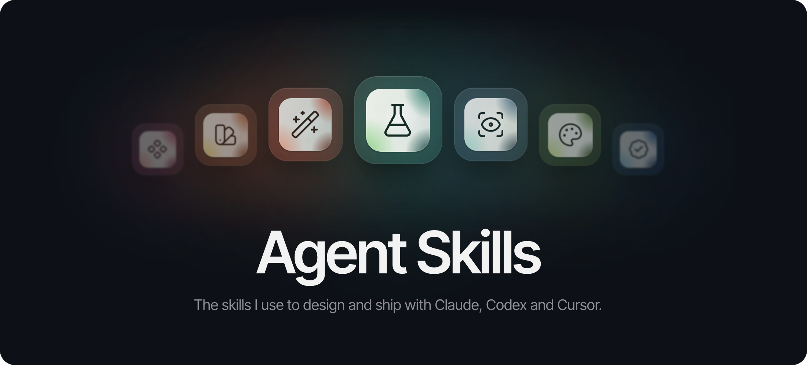

<p align="center">
  
</p>

<p align="center">
  <strong>A product designer's workflow, as agent skills.</strong><br>
  I'm <a href="https://github.com/tonygorb">Tony Gorb</a>, a product designer. With these ten skills my coding agent
  shows me options before it builds, looks at the real screen before it says done, and keeps code
  and Figma in step.
</p>

```sh
npx skills add tonygorb/skills
```

Works in Claude Code, the Claude app, Codex, Cursor, GitHub Copilot, Gemini CLI and
[other tools that read the open Agent Skills format](https://agentskills.io/clients).
More ways to install [below](#install).

## The skills

### Explore · before anything is built

<p><a href="skills/concept-lab/SKILL.md"><b>Concept lab</b></a><br>Builds 3-5 real concepts side by side; you pick one.</p>

<p><a href="skills/evolve/SKILL.md"><b>Evolve</b></a><br>Audits one part of the code and ranks what to improve. Changes nothing.</p>

### Build · inside the system you already have

<p><a href="skills/design-within-what-exists/SKILL.md"><b>Design within what exists</b></a><br>Changes a screen with the patterns it already has, not new ones.</p>

<p><a href="skills/unugly/SKILL.md"><b>Unugly</b></a><br>Finds what makes AI-built UI look generic; fixes it once you approve.</p>

### Check · before anyone says it's done

<p><a href="skills/review-a-screen/SKILL.md"><b>Review a screen</b></a><br>Looks at the screen in a browser at laptop and phone size, like a designer would.</p>

<p><a href="skills/verify-work/SKILL.md"><b>Verify work</b></a><br>Proves a change works with real checks: lint, types, tests, screenshots.</p>

### Ship · when the work is done

<p><a href="skills/wrap-up/SKILL.md"><b>Wrap up</b></a><br>Lists the changes, fixes stale docs, runs the checks, drafts the commit. Never commits.</p>

### Design system · tokens in code, mirrored in Figma

<p><a href="skills/token-foundations/SKILL.md"><b>Token foundations</b></a><br>Builds or audits semantic tokens in OKLCH, light and dark, with measured contrast.</p>

<p><a href="skills/polish-design-system/SKILL.md"><b>Polish a design system</b></a><br>Finds hard-coded colours, proposes tokens, applies them once you approve.</p>

<p><a href="skills/tokens-to-figma/SKILL.md"><b>Tokens to Figma</b></a><br>Pushes the code's tokens into Figma as variables with Light and Dark modes.</p>

`tokens-to-figma` needs the [Figma MCP server](https://help.figma.com/hc/en-us/articles/32132100833559) with
write access. The skills that look at screens (`review-a-screen`, `concept-lab`, `verify-work`,
`unugly`) expect an agent that can open a browser and take screenshots, for example through the
Playwright or Chrome DevTools MCP server.

## Install

**Claude Code**, as a plugin:

```text
/plugin marketplace add tonygorb/skills
/plugin install tonygorb-skills@tonygorb
```

**Any agent** (Claude Code, Codex, Cursor, Copilot, Gemini CLI and more), with the open-source
[`skills`](https://github.com/vercel-labs/skills) CLI. It asks which skills and which agents:

```sh
npx skills add tonygorb/skills
```

**The Claude app** (claude.ai and desktop): download a skill's ZIP from the
[latest release](https://github.com/tonygorb/skills/releases/latest), then upload it under
Customize → Skills.

**By hand:** copy a skill's folder into `.claude/skills/` (Claude Code) or `.agents/skills/`
(most other agents).

## Use

Skills load by themselves when a request matches. Ask the way you normally would:

- "Show me three options for the pricing section." → `concept-lab`
- "Set up design tokens for this app, brand colour #3b5bdb." → `token-foundations`
- "Sync our tokens to this Figma file: <link>." → `tokens-to-figma`
- "This looks AI-generated. Make it less generic." → `unugly`
- "Wrap up." → `wrap-up`

Or name one directly: "Use verify-work before you tell me it's done."

## Feedback

Found a problem or have an idea? [Open an issue](https://github.com/tonygorb/skills/issues).
This is a personal, curated set, so pull requests aren't accepted.

## Credits

`unugly` is adapted from [Impeccable](https://github.com/pbakaus/impeccable) by Paul Bakaus;
`verify-work` borrows a principle and a format from [superpowers](https://github.com/obra/superpowers)
by Jesse Vincent. Each skill names what it took.

## Licence

MIT, © 2026 Tony Gorb (see [`LICENSE`](LICENSE)), except `unugly`, which is Apache-2.0 because it is
adapted from Impeccable (see [`skills/unugly/LICENSE.txt`](skills/unugly/LICENSE.txt)).

## Maintaining

1. **One folder per skill:** `skills/<name>/SKILL.md`. The folder name is the skill's `name`.
2. **Only `skills/` is published.** Work in progress lives in a local `drafts/` folder, which git ignores.
   A new skill also goes in `.claude-plugin/marketplace.json` (the validator checks both lists match).
3. **`node scripts/validate.mjs` must pass** (CI runs it on every push). It checks the spec, the frontmatter
   below, and that no personal paths, emails or secret-looking strings slip in.

Releases: `git tag v1.1.0 && git push origin v1.1.0` publishes a GitHub release with one ZIP per
skill (`.github/workflows/release.yml`).

```yaml
---
name: verify-work            # lowercase, numbers, single hyphens; = folder name
description: What it does. Use when …   # up to 200 characters (the Claude app's limit)
license: MIT
metadata:
  author: Tony Gorb
  source: https://github.com/tonygorb/skills
  category: workflow          # one of: design, design-systems, figma, workflow, quality, writing
  cover: "3 tiers"            # optional: the big word on its cover on the website
---
```
